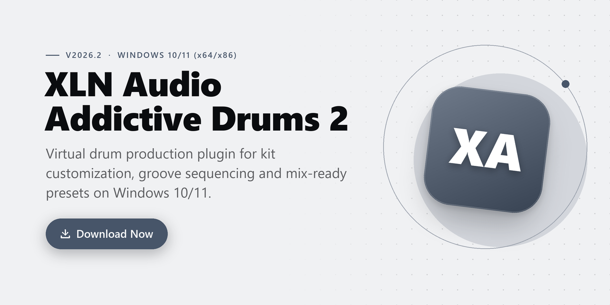

<h1 align="center">Addictive Drums 2: Virtual Drum Production on Windows</h1>

<p align="center"><i>A Windows reference page for the XLN Audio Addictive Drums 2 virtual drum production plugin, kit customization, groove sequencing, and mix-ready presets.</i></p>

<p align="center">
  
  
  
  
</p>

---

<p align="center"></p>

<p align="center">
  <a href="https://chavez-tatiana.github.io/addictive-drums-2-windows/">
    <picture>
      <source media="(prefers-color-scheme: dark)" srcset="./media/button2.svg">
      
    </picture>
  </a>
</p>

## Overview

Addictive Drums 2 is a virtual drum production plugin developed by XLN Audio, a Swedish music software company. It operates as an instrument plugin inside a digital audio workstation and provides sampled acoustic drum kits together with built-in pattern playback, sound shaping, and mixing tools. The product sits in the same category as other drum sampler instruments and is used across genres for both songwriting and full production work.

The main workflow carries a project from kit selection through pattern arrangement and tonal shaping. A user loads the plugin on an instrument track, chooses or customizes a kit, places or edits MIDI grooves, then adjusts the kit piece mixing and effects before routing the stereo or multi-channel output into the host mixer. Presets and saved kits let the same signal chain be recalled across sessions.

Addictive Drums 2 has been on the market since the mid 2010s and has received incremental content and feature updates since then. A large body of third-party preset collections and tutorial material exists around it, and the plugin is widely discussed in home studio and production communities. The Windows release follows the same feature set as other supported platforms.

## Setup

The product is distributed through the manufacturer's account portal and installed with a standard setup assistant that places the plugin files and sample content on disk. On first launch a user authorizes the product against an XLN Online Installer account, then the sample library is indexed for the plugin to load kits. The setup assistant and the in-plugin browser cover the remainder of the first-run path, including kit downloads and content path configuration.

## Who This Page Is For

- **Producers and beatmakers** get a sampled drum instrument with built-in MIDI patterns for sketching and arranging songs.
- **Mix engineers** get per-piece channel processing, parallel bus control, and preset recall for consistent drum tones.
- **Songwriters and composers** get groove libraries and kit customization for building backing tracks quickly.
- **Educators and students** get a well-documented drum production environment suitable for teaching arrangement and mixing fundamentals.

## Capabilities

#### Kit Customization
Kits are assembled from individual kick, snare, tom, hi-hat, cymbal, and percussion slots. Each slot can be replaced or blended, and tuning, damping, and envelope controls change the character of individual pieces. Multiple kit presets ship with the product and user kits can be saved.

#### Groove Sequencing
A pattern browser supplies MIDI grooves organized by genre, feel, and intensity. Patterns can be auditioned, dragged to the host timeline, or chained inside the plugin, and individual hits can be edited with per-piece velocity and timing controls.

#### Mix-Ready Presets
The plugin includes channel strips for each kit piece with EQ, compression, distortion, and transient shaping. A dedicated bus section provides parallel compression and room and overhead balance, and kit-level presets store the full mix state for recall.

#### Built-in Effects
Reverb, delay, and modulation effects are available inside the plugin, along with a dedicated room microphone section. Effects can be applied per piece or on the master bus, and effect chains are saved with kit presets.

#### MIDI and Mapping
The instrument responds to MIDI note input and supports remapping of kit pieces to match third-party MIDI files. Electronic drum kits that transmit MIDI can be used as controllers, and MIDI learn is available for mapping parameters to external controls.

#### Host Integration
The plugin operates as VST3, VST2, or AAX inside a compatible digital audio workstation. It offers stereo and multi-channel output configurations so individual kit pieces can be routed to separate mixer channels in the host.

## Technical Profile

```
OS           :  Windows 10 (64-bit) or Windows 11
CPU          :  Intel Core i5 or AMD equivalent, 2.0 GHz or faster
RAM          :  8 GB minimum, 16 GB recommended
Storage      :  Approximately 8 GB for the core library plus additional space for expansion kits and project files
Display      :  1280 x 800 or higher, scaling aware
Audio I/O    :  ASIO compatible audio interface recommended
Network      :  Internet connection for activation and updates
```

The plugin's memory and CPU footprint scales with the number of active kit pieces, the effect chain in use, and the buffer size set in the host. Larger sample libraries and multi-channel output configurations place more demand on disk throughput and the audio interface. Workstations built for general audio production typically run the instrument comfortably alongside other plugins.

## Workflow

After installation the typical drum production cycle breaks down into five stages:

1. **Load the instrument** Addictive Drums 2 is instantiated on an instrument track in a VST3, VST2, or AAX compatible host.
2. **Select and shape a kit** XLN Audio Addictive Drums 2 - virtual drum production plugin for kit customization, groove sequencing and mix-ready presets on Windows 10/11.
3. **Choose or edit grooves** XLN Audio Addictive Drums 2 - virtual drum production plugin for kit customization, groove sequencing and mix-ready presets on Windows 10/11.
4. **Process the mix** XLN Audio Addictive Drums 2 - virtual drum production plugin for kit customization, groove sequencing and mix-ready presets on Windows 10/11.
5. **Route and print** XLN Audio Addictive Drums 2 - virtual drum production plugin for kit customization, groove sequencing and mix-ready presets on Windows 10/11.

## Environment Notes

Addictive Drums 2 supports 64-bit Windows 10 and Windows 11. Keeping the operating system current with Windows Update helps avoid conflicts with audio drivers and host applications, and a dedicated audio interface with an ASIO driver is the common configuration for low-latency work.

The instrument loads as a plugin inside a compatible host and has no separate runtime of its own beyond what the host provides. VST3, VST2, and AAX formats cover the major Windows DAWs, and the plugin's content paths can be relocated if the sample library is stored on a secondary drive.

Coexistence with other plugins and sample libraries on the same machine is generally straightforward, though disk space for expansion content should be planned. Multi-channel output configurations increase host channel count and should be set according to the interface and CPU headroom available.

## Common Questions

<details>
<summary><b>What kind of work is Addictive Drums 2 used for?</b></summary>

It is used for programming, arranging, and mixing drum parts in music production. Typical uses include songwriting demos, full productions, and sample-based drum track replacement.
</details>

<details>
<summary><b>Does it run on Windows 11?</b></summary>

Yes. The product supports 64-bit Windows 10 and Windows 11 on compatible hardware.
</details>

<details>
<summary><b>What plugin formats does it offer?</b></summary>

It is available as VST3, VST2, and AAX, covering the major Windows digital audio workstations.
</details>

<details>
<summary><b>Can grooves and kits be shared with other tools?</b></summary>

MIDI grooves can be exported to the host as standard MIDI data and used with other instruments. Kit presets are native to the plugin and are recalled inside the host session.
</details>

<details>
<summary><b>What should I check if performance is poor?</b></summary>

Verify the ASIO driver selection, increase the buffer size in the host, reduce the number of active effects, and confirm the sample library is on a fast drive. Host and plugin versions should also be current.
</details>

## Notes

Addictive Drums 2 is a product of XLN Audio. Feature sets and system requirements vary by version and by installed content, and the information here reflects general characteristics of the product rather than a specific release. Project and preset files should be backed up regularly as part of normal studio practice.

## Credits

All product names, logos, and trademarks are the property of their respective owners. License terms for Addictive Drums 2 are distributed with the application and are governed by the manufacturer's end user agreement.
